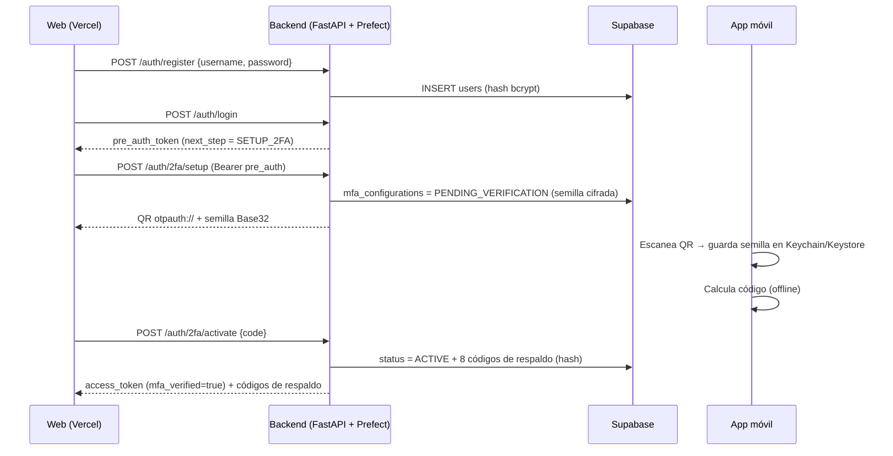
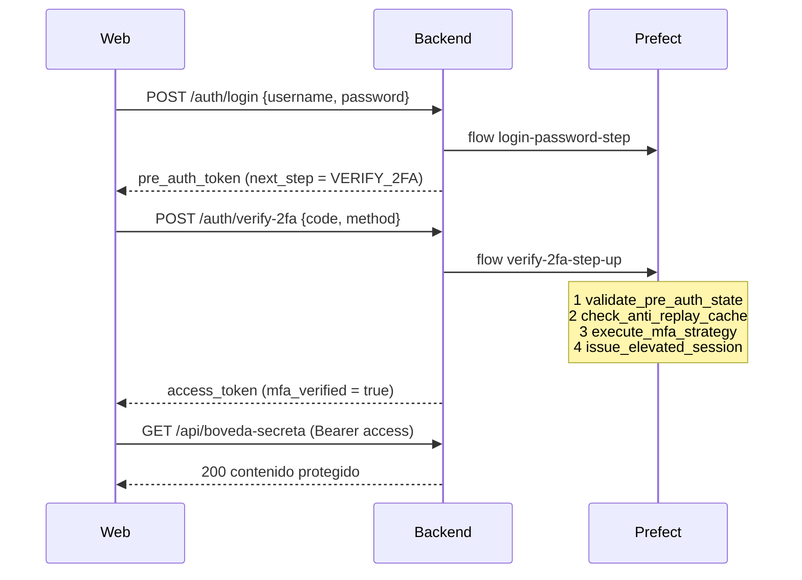

# Documentación técnica: TallerMFA

Documento de referencia para la sustentación. Explica **qué** se construyó, **cómo** funciona por dentro, **dónde** vive cada dato y **por qué** se tomó cada decisión. Al final hay un banco de preguntas probables con su respuesta.

> Para instalar y ejecutar el proyecto, ver el [README.md](README.md).

---

## Índice

1. [Visión general](#1-visión-general)
2. [Flujo completo paso a paso](#2-flujo-completo-paso-a-paso)
3. [App móvil: algoritmo TOTP desde cero](#3-app-móvil-algoritmo-totp-desde-cero)
4. [¿Dónde se guardan los secretos?](#4-dónde-se-guardan-los-secretos)
5. [Backend: API, flows y tasks de Prefect](#5-backend-api-flows-y-tasks-de-prefect)
6. [Patrones arquitectónicos](#6-patrones-arquitectónicos)
7. [Anti-replay e idempotencia](#7-anti-replay-e-idempotencia)
8. [Tokens JWT (Step-Up)](#8-tokens-jwt-step-up)
9. [Base de datos (Supabase)](#9-base-de-datos-supabase)
10. [Web de login](#10-web-de-login)
11. [Observabilidad con Prefect](#11-observabilidad-con-prefect)
12. [Seguridad: decisiones y limitaciones](#12-seguridad-decisiones-y-limitaciones)
13. [Pruebas](#13-pruebas)
14. [Banco de preguntas para la sustentación](#14-banco-de-preguntas-para-la-sustentación)

---

## 1. Visión general

| Componente | Tecnología | Responsabilidad |
|---|---|---|
| `mobile-authenticator/` | React Native + Expo SDK 58 (TypeScript) | Guarda la semilla y calcula el código de 6 dígitos cada 30 s **sin red** |
| `backend-prefect/` | Python, FastAPI, Prefect 3 | Autenticación escalonada, aprovisionamiento 2FA y validación. Cada operación es un `@flow` observable |
| `web-login/` | React + Vite, desplegada en Vercel | Interfaz de registro, login, activación 2FA, verificación y bóveda |
| `supabase/` | PostgreSQL (Supabase) | Usuarios, configuración 2FA, códigos de respaldo y bitácora |
| ngrok | Túnel HTTPS | Expone el backend local a la web de Vercel |

**Idea clave:** el teléfono y el servidor **nunca se comunican**. Se sincronizan porque los dos tienen:

1. el mismo **secreto** (compartido una sola vez con el QR), y
2. la misma **hora** (Unix time).

Con esos dos datos, ambos calculan `HMAC-SHA1(secreto, ⌊t/30⌋)` y obtienen el mismo número.

---

## 2. Flujo completo paso a paso

### 2.1 Aprovisionamiento (activar 2FA por primera vez)



### 2.2 Login normal (2FA ya activa)



---

## 3. App móvil: algoritmo TOTP desde cero

### 3.1 Restricción de la guía

No se usan librerías que entreguen el código TOTP ya calculado (otplib, speakeasy, etc.). Se fue un paso más allá: **SHA-1, HMAC y Base32 también están escritos a mano**, así que la app no tiene ninguna dependencia criptográfica.

| Archivo | Qué implementa | Estándar |
|---|---|---|
| `src/crypto/base32.ts` | Decodificación Base32 (5 bits por carácter) | RFC 4648 |
| `src/crypto/sha1.ts` | SHA-1: padding, 80 rondas, 5 registros de 32 bits | FIPS 180-4 |
| `src/crypto/hmac.ts` | HMAC: `H((K⊕opad) ‖ H((K⊕ipad) ‖ m))`, bloque de 64 bytes | RFC 2104 |
| `src/crypto/totp.ts` | Contador, empaquetado, truncamiento dinámico | RFC 4226 / 6238 |
| `src/crypto/otpauth.ts` | Lectura de la URI `otpauth://totp/...` | Key URI Format (Google) |

### 3.2 Los 5 pasos (función `hotp` en `totp.ts`)

1. **Base32 → bytes:** `K = base32Decode(secret)`. 32 caracteres Base32 equivalen a 20 bytes (160 bits).
2. **Contador:** `C = Math.floor(UnixTime / 30)`, con el reloj **local** del teléfono (`Date.now()`).
3. **8 bytes Big-Endian:** `DataView.setUint32(0, alto)` y `setUint32(4, bajo)`. Hacen falta dos mitades porque los operadores de bits de JavaScript trabajan con 32 bits.
4. **HMAC-SHA1(K, C):** produce 20 bytes.
5. **Truncamiento dinámico:**
   - `offset = hash[19] & 0x0f`, un número entre 0 y 15.
   - Se toman 4 bytes desde `offset`. El primero se enmascara con `& 0x7f` para quitar el bit de signo y obtener un entero positivo de 31 bits.
   - `valor % 1_000_000` y luego `padStart(6, '0')`.

### 3.3 Interfaz

- Código en tamaño grande, separado en dos mitades (`123 456`) para leerlo más fácil.
- Contador circular y barra de progreso de 30 a 0. Se pone **rojo** en los últimos 5 s.
- Se muestra el valor de `C = ⌊t/30⌋` para poder explicar el algoritmo en vivo.
- Un reloj interno (`useNow`) se actualiza cada 250 ms. El HMAC **solo se recalcula cuando cambia `C`** (`useMemo`), no 4 veces por segundo.
- **Tocar** una cuenta copia el código. **Mantener presionado** la elimina.
- Hay dos formas de agregar una cuenta: **escanear el QR** con `expo-camera` o **pegar la semilla** (o la URI completa) a mano, útil en emuladores sin cámara.
- Si se escanea de nuevo una cuenta con el mismo emisor y usuario, la semilla anterior se reemplaza.

### 3.4 ¿Por qué funciona en modo avión?

La app **no hace ninguna petición de red**. No hay `fetch` en todo el código: la cámara solo lee el QR localmente y el cálculo usa el reloj del dispositivo. Una vez cargada en Expo Go, el JavaScript ya está en memoria.

Lo único que necesita red es descargar el bundle cuando se abre por primera vez en Expo Go; eso es propio del entorno de desarrollo, no de la app.

### 3.5 Verificación de paridad

`npm run test:totp` ejecuta `scripts/verify-totp.ts`, que comprueba lo siguiente:

- SHA-1 contra vectores FIPS y contra `node:crypto` para tamaños límite (55, 56, 63, 64, 65 y 1000 bytes, que son los casos frontera del padding).
- HMAC contra el RFC 2202 y con una llave de 100 bytes (mayor que el bloque, por lo que se le aplica hash primero).
- HOTP contra los 10 vectores del RFC 4226.
- TOTP contra los 6 vectores del RFC 6238.
- Además, para una misma semilla se confirmó que la app y el backend en Python generan **el mismo código**.

Como sigue el estándar RFC 6238 al pie de la letra, el código coincide con Google y Microsoft Authenticator.

---

## 4. ¿Dónde se guardan los secretos?

> Esta es la sección más probable de preguntas.

### 4.1 En el teléfono

| Dato | Dónde | Cómo está protegido |
|---|---|---|
| **Semilla TOTP** (y emisor, usuario, dígitos, periodo) | `expo-secure-store`, clave `otp_accounts_v1`, un JSON con la lista de cuentas | **iOS:** en el **Keychain** del sistema, como *generic password*, con accesibilidad `WHEN_UNLOCKED` (solo legible con el teléfono desbloqueado). **Android:** en `SharedPreferences`, **cifrado con una llave del Android Keystore** (la llave vive en el hardware seguro o TEE y no se puede exportar). |
| Código actual de 6 dígitos | Solo en memoria (estado de React) | No se persiste. Se recalcula desde la semilla. |
| Código copiado | Portapapeles del sistema (`expo-clipboard`), solo si el usuario toca la tarjeta | Lo maneja el sistema operativo |

Otros detalles:

- **No se usa `AsyncStorage`**, porque guarda texto plano.
- **Aislamiento:** cada proyecto Expo tiene su propio almacenamiento y no puede leer el de otros proyectos (documentación de `expo-secure-store`).
- **En Expo Go**, los datos quedan dentro del almacenamiento seguro de la app Expo Go, aislados por proyecto. En una build propia (APK/IPA) quedarían en el de la app.
- **Al desinstalar:**
  - En Android los datos se borran.
  - En iOS el Keychain puede conservarlos si se reinstala con el mismo bundle ID, pero no está garantizado.
- La semilla **nunca sale del teléfono**: la app no tiene red.

### 4.2 En el backend y la base de datos

| Dato | Dónde | Cómo está protegido |
|---|---|---|
| **Contraseña** | `users.password_hash` (Supabase) | **bcrypt** con sal aleatoria y costo 12. Es irreversible. |
| **Semilla TOTP** | `mfa_configurations.secret_encrypted` | **Cifrada con Fernet** (AES-128-CBC + HMAC-SHA256). La llave sale de `SECRET_ENCRYPTION_KEY` o, si está vacía, se deriva con `SHA-256("totp-seed:" + JWT_SECRET)`. Hace falta la semilla en claro para validar, por eso se cifra y no se hashea. |
| **Códigos de respaldo** | `backup_codes.code_hash` | **SHA-256** del código normalizado. Solo se muestran en claro **una vez**, al activar. |
| `JWT_SECRET`, `SUPABASE_SERVICE_KEY`, `SECRET_ENCRYPTION_KEY` | Archivo `backend-prefect/.env` | Excluido de Git (`.gitignore`). Nunca llega al navegador ni al teléfono. |
| **Caché anti-replay** | Memoria del proceso (diccionario de Python) | Expira a los 90 s. |
| **Sesiones pre-auth** (intentos, consumido) | Memoria del proceso | Expira a los 5 min. |

### 4.3 En la web (navegador)

| Dato | Dónde | Nota |
|---|---|---|
| `pre_auth_token` y `access_token` | **Solo en el estado de React (memoria)** | No se guardan en `localStorage` ni en cookies. Si recargas la página, se pierde la sesión, y es intencional. |
| Último código TOTP usado | `sessionStorage` (`tallermfa:last-used-code`) | Solo para el botón *"Demo anti-replay"*. Es un código ya consumido e inútil. |
| `VITE_API_URL` (link de ngrok) | Archivo `web-login/.env.production`, incrustado al compilar | Es una URL pública, no un secreto. |

### 4.4 Lo que el usuario ve en el QR

La URI tiene esta forma:

```
otpauth://totp/TallerMFA:ana?secret=JBSWY3...&issuer=TallerMFA&algorithm=SHA1&digits=6&period=30
```

El QR **contiene la semilla en claro**. Por eso solo se muestra una vez, protegido por el `pre_auth_token`, y la web no lo guarda.

---

## 5. Backend: API, flows y tasks de Prefect

### 5.1 Estructura

```
backend-prefect/app/
├── main.py                   # Endpoints FastAPI, CORS, manejo de errores
├── config.py                 # Variables de entorno (.env); define PREFECT_API_URL antes de importar Prefect
├── core/
│   ├── totp.py               # TOTP desde cero (hmac + hashlib.sha1 + base64 de la librería estándar)
│   ├── tokens.py             # Emisión y validación de JWT
│   └── security.py           # bcrypt, Fernet, códigos de respaldo, enmascarado
├── domain/
│   ├── models.py             # User, MfaConfiguration, MfaStatus
│   ├── state_machine.py      # Transiciones permitidas
│   ├── provisioning.py       # Process Manager
│   ├── strategies.py         # Strategy Pattern
│   └── exceptions.py         # Errores de dominio → HTTP
├── infrastructure/
│   ├── repositories.py       # Repository: Supabase (REST) | SQLite
│   ├── anti_replay.py        # Caché anti-replay
│   └── pre_auth_store.py     # Estado intermedio de autenticación
└── flows/
    ├── tasks.py              # @task
    └── auth_flows.py         # @flow
```

### 5.2 Endpoints

| Endpoint | Token requerido | Flow | Respuesta |
|---|---|---|---|
| `POST /auth/register` | — | — | Usuario creado (`NOT_CONFIGURED`) |
| `POST /auth/login` | — | `login-password-step` | `pre_auth_token`, `mfa_status`, `next_step` |
| `POST /auth/2fa/setup` | pre_auth | `mfa-provisioning-start` | QR (PNG base64), semilla, URI |
| `POST /auth/2fa/activate` | pre_auth | `mfa-provisioning-activate` | `access_token` y códigos de respaldo |
| `POST /auth/verify-2fa` | pre_auth | `verify-2fa-step-up` | `access_token`, `matched_window`, `method` |
| `GET /api/boveda-secreta` | access con `mfa_verified=true` | — | Contenido protegido |
| `GET /health` | — | — | Estado, BD en uso, URL de Prefect |
| `GET /` | — | — | Redirige a `/docs` (Swagger) |

### 5.3 Flows y sus tasks

| Flow | Tasks en orden |
|---|---|
| `login-password-step` | `authenticate_credentials` → `resolve_mfa_status` → `issue_pre_auth_token` |
| `verify-2fa-step-up` | `validate_pre_auth_state` → `check_anti_replay_cache` → `execute_mfa_strategy` → `issue_elevated_session` |
| `mfa-provisioning-start` | `validate_pre_auth_state` → `start_mfa_provisioning` → `render_provisioning_qr` |
| `mfa-provisioning-activate` | `validate_pre_auth_state` → `check_anti_replay_cache` → `execute_mfa_strategy` → `activate_mfa_configuration` → `issue_elevated_session` |

Las 4 tasks que exige la guía:

1. **`validate_pre_auth_state`**
   - Comprueba la firma, la expiración, la audiencia (`mfa-verification`) y el scope (`pre_auth`) del JWT.
   - Comprueba que la sesión siga **viva en el servidor**: no consumida ni expirada.
   - Comprueba que el usuario exista.
2. **`check_anti_replay_cache`**
   - Si `(user_id, código)` se usó en los últimos 90 s, lanza `ReplayAttackDetected`.
   - La task queda **Failed** (roja) en Prefect.
3. **`execute_mfa_strategy`**
   - Verifica que la 2FA esté en el estado requerido: `ACTIVE` para el login, `PENDING_VERIFICATION` para la activación.
   - Elige la estrategia y la ejecuta.
   - Registra con `get_run_logger()` **qué ventana hizo match**: `C-1` (reloj atrasado), `C` o `C+1` (reloj adelantado).
   - Si el código falla, suma un intento. Al 5.º intento invalida el pre_auth_token (`TooManyAttempts`, HTTP 429).
4. **`issue_elevated_session`**
   - Marca el código como usado de forma atómica.
   - Consume el pre_auth_token (un solo uso).
   - Emite el JWT final con `mfa_verified: true`.

### 5.4 Detalles de implementación

- **`cache_policy=NO_CACHE`** en todas las tasks. Prefect puede reutilizar resultados de tasks con las mismas entradas. En autenticación eso sería un *bypass*, porque podría devolverse un "válido" anterior. Por eso cada intento se evalúa de nuevo.
- **`retries=0`.** Un reintento automático de un código inválido no tiene sentido y además gastaría intentos.
- **`SecretStr` en los parámetros de los flows.** Prefect guarda y muestra los parámetros de cada run. Con `SecretStr`, la contraseña, el pre_auth_token y el código aparecen como `**********` en la UI.
- **Los logs enmascaran los códigos** (`24****`) con la función `mask()`.
- **Tiempo constante en el login.** Si el usuario no existe, igual se ejecuta `bcrypt.checkpw` contra un hash de relleno, para que el tiempo de respuesta no revele qué usuarios existen (*user enumeration*).
- **El backend también implementa TOTP desde cero** con la librería estándar de Python (`hmac`, `hashlib`, `struct`, `base64`), sin `pyotp`.
- **Comparación segura:** `hmac.compare_digest` en lugar de `==`, para evitar ataques de temporización.
- **Errores de dominio:** cada excepción (`ReplayAttackDetected`, `InvalidSecondFactor`, etc.) tiene su código HTTP y un identificador estable que la web muestra, por ejemplo `REPLAY_ATTACK_DETECTED`.

---

## 6. Patrones arquitectónicos

### 6.1 Máquina de estados + Process Manager (aprovisionamiento seguro)

```
NOT_CONFIGURED ──setup──▶ PENDING_VERIFICATION ──primer código válido──▶ ACTIVE
                                 ▲    │
                                 └────┘  setup de nuevo (regenera QR)
```

| Desde \ Hacia | PENDING_VERIFICATION | ACTIVE |
|---|---|---|
| NOT_CONFIGURED | ✅ | ❌ |
| PENDING_VERIFICATION | ✅ (nuevo QR) | ✅ |
| ACTIVE | ❌ | ❌ |

- **Implementación:** `ALLOWED_TRANSITIONS` en `state_machine.py`. `assert_transition()` lanza `InvalidStateTransition` (HTTP 409).
- **Process Manager** (`MfaProvisioningProcess`): coordina un proceso **de larga duración** en dos pasos separados en el tiempo, porque el usuario puede tardar minutos en escanear.
  - `start()`: genera la semilla, la cifra y deja la 2FA en `PENDING_VERIFICATION`.
  - `complete()`: valida la transición, la pasa a `ACTIVE`, pone `activated_at` y genera los códigos de respaldo.
  - Es el **único** lugar que cambia el estado.
- **Por qué existe `PENDING_VERIFICATION`:** si el usuario genera el QR y nunca lo escanea, el login **no le exige 2FA** (sigue en `SETUP_2FA`) y no queda bloqueado. Solo cuando demuestra que su teléfono genera códigos válidos se activa.
- **Por qué `ACTIVE → PENDING` está prohibido:** si alguien roba la contraseña, no puede re-aprovisionar la 2FA para meter su propio teléfono, porque eso exigiría solo la contraseña.

### 6.2 Step-Up Authentication

| | `pre_auth_token` | `access_token` |
|---|---|---|
| Lo entrega | `POST /auth/login` (solo contraseña) | `/auth/verify-2fa` o `/auth/2fa/activate` |
| `aud` | `mfa-verification` | `api` |
| `scope` | `pre_auth` | `access` |
| `mfa_verified` | `false` | `true` |
| `amr` | — | `["pwd","otp"]` o `["pwd","backup_code"]` |
| Duración | 5 min | 15 min |
| Uso | **Un solo uso**, máx. 5 intentos fallidos | Rutas protegidas `/api/*` |
| Sirve para | `/auth/verify-2fa`, `/auth/2fa/*` | `/api/boveda-secreta` |

La separación se garantiza con la **audiencia (`aud`)**. PyJWT rechaza un token cuya `aud` no coincide, así que un `pre_auth_token` nunca puede abrir la bóveda aunque tenga una firma válida. Además, la dependencia `require_mfa_session` exige `mfa_verified is True`.

### 6.3 Strategy Pattern

```python
class SecondFactorStrategy(ABC):
    def verify(self, config, code) -> VerificationResult: ...

class TOTPStrategy(SecondFactorStrategy):        # ventanas C-1, C, C+1
class BackupCodeStrategy(SecondFactorStrategy):  # código de un solo uso

resolve_strategy(method, repository)  # "totp" | "backup" → instancia
```

- La task `execute_mfa_strategy` **no sabe** qué estrategia ejecuta: solo llama a `verify()`.
- Agregar un tercer factor (SMS, WebAuthn) consistiría en crear otra clase y registrarla en `resolve_strategy`, sin tocar el flow. Eso es el principio *Open/Closed*.
- `BackupCodeStrategy` consume el código con un `UPDATE ... WHERE used_at IS NULL`, que es **atómico** en Postgres.

### 6.4 Repository Pattern

`UserRepository` (clase abstracta) tiene dos implementaciones:

- `SupabaseRepository`: usa la API REST de Supabase (PostgREST) con `httpx`.
- `SQLiteRepository`: para pruebas o si no hay Supabase configurado.

El dominio y los flows nunca saben qué base de datos se usa. `get_repository()` elige según `.env`.

---

## 7. Anti-replay e idempotencia

**El problema:** un código TOTP sigue siendo matemáticamente válido durante su ventana. Además, el servidor acepta 3 ventanas (C-1, C, C+1), es decir, hasta 90 s. Sin control, alguien que vea el código (por encima del hombro, *phishing* en tiempo real, un log) podría reutilizarlo.

**La solución** (`anti_replay.py`):

- Un diccionario en memoria `{(user_id, código): expira_en}` protegido con `threading.Lock`.
- **TTL de 90 s** = 3 ventanas × 30 s, el tiempo máximo que el código podría ser aceptado. Pasado ese tiempo ya no es válido y no hace falta recordarlo.
- `check_anti_replay_cache` (task 2) **consulta**. `issue_elevated_session` (task 4) **marca** el código.
- **Condición de carrera:** dos peticiones simultáneas con el mismo código podrían pasar las dos la consulta. Por eso `mark_used()` es **atómico** (consulta e inserta bajo el mismo lock) y devuelve `False` si otro request ganó; en ese caso también se lanza `ReplayAttackDetected`.
- Los códigos de respaldo usan la clave `backup:XXXXXXXX`, así que no chocan con los TOTP. Además, en la BD son de un solo uso.
- El código se marca **solo cuando el login tiene éxito**. Un código inválido no entra a la caché.
- Un replay se detecta **antes** de evaluar la estrategia, así que no cuenta como intento fallido.

**Demostración:** se activa con el código `X` y luego se intenta el login con el mismo `X`. El flow queda `Failed` en `check_anti_replay_cache` y la web muestra *"⛔ Ataque de repetición bloqueado"*.

---

## 8. Tokens JWT (Step-Up)

- **Algoritmo:** HS256 (HMAC-SHA256), con secreto simétrico `JWT_SECRET`.
- **Claims validados al decodificar:** `exp`, `sub`, `jti`, `aud`, `iss` (obligatorios) y `scope`.
- **`jti`** (ID único) enlaza el JWT con la sesión en `PreAuthStore`. Eso permite:
  - **Invalidarlo antes de que expire:** al emitir el `access_token` se marca como consumido.
  - **Contar intentos fallidos** por sesión.
- Un JWT es *stateless*. El `PreAuthStore` le agrega el **estado intermedio** que la guía pide gestionar (la frase *"cómo gestionar estados intermedios de autenticación"*).

---

## 9. Base de datos (Supabase)

Script: [`supabase/schema.sql`](supabase/schema.sql).

| Tabla | Columnas clave | Notas |
|---|---|---|
| `users` | `id uuid`, `username` (único, `^[a-z0-9_.-]{3,40}$`), `password_hash` | bcrypt |
| `mfa_configurations` | `user_id` (PK y FK), `secret_encrypted`, `status`, `activated_at` | `CHECK status IN ('PENDING_VERIFICATION','ACTIVE')`, `CHECK` de que `ACTIVE` implica `activated_at`. Sin fila significa `NOT_CONFIGURED`. |
| `backup_codes` | `user_id`, `code_hash`, `used_at` | `UNIQUE(user_id, code_hash)`, índice parcial `WHERE used_at IS NULL` |
| `auth_audit_log` | `user_id`, `event`, `detail`, `flow_run_id` | Cada evento queda enlazado a su run de Prefect |

**Eventos de auditoría:** `LOGIN_FAILED`, `PRE_AUTH_ISSUED`, `MFA_PENDING_VERIFICATION`, `MFA_ACTIVE`, `MFA_FAILED`, `REPLAY_ATTACK_DETECTED`, `MFA_VERIFIED`.

**Seguridad (RLS):**

- Row Level Security está **activado sin políticas** y se revocaron los permisos a `anon` y `authenticated`. Las llaves públicas de Supabase no pueden leer ni escribir nada.
- El backend usa la **llave secreta** (`sb_secret_...` o `service_role`), que omite RLS y solo vive en el `.env` del servidor.
- La web **nunca habla con Supabase directamente**; todo pasa por el backend.

---

## 10. Web de login

- **Stack:** React 19 + Vite + TypeScript, sin librerías extra. Desplegada en Vercel (`vercel.json`, Root Directory `web-login`).
- **Pantallas:**
  - Credenciales (login o registro).
  - Si la 2FA no está activa: **Activar 2FA** (QR, semilla, código) y luego **Códigos de respaldo**.
  - Si la 2FA está activa: **Verificación** (pestañas `TOTPStrategy` / `BackupCodeStrategy`).
  - En ambos casos se termina en la **Bóveda**.
- Muestra una cuenta regresiva del `pre_auth_token` y los *claims* decodificados de cada token, para explicar el Step-Up en la demo.
- **Conexión con el backend:**
  - La URL sale de `VITE_API_URL`. En producción viene de `web-login/.env.production`, que contiene el link de ngrok.
  - Cada petición manda el header `ngrok-skip-browser-warning: true`. ngrok gratis responde a los navegadores con una página HTML de aviso que rompería el `fetch`, y este header la omite.
  - El backend permite ese header por CORS y responde `Access-Control-Allow-Private-Network` por si la web llama a `localhost`.
- **Validación:** el formulario aplica las mismas reglas que el backend (usuario `[A-Za-z0-9_.-]`, 3 a 40 caracteres; contraseña de al menos 8). Los errores 422 se traducen a mensajes legibles.

---

## 11. Observabilidad con Prefect

- `prefect server start` levanta la UI en `http://127.0.0.1:4200`. El backend se reporta allí porque `PREFECT_API_URL` se fija en `config.py` **antes** de importar Prefect.
- **Qué se ve en la UI:**
  - **Runs:** cada login o verificación es un run con nombre legible (`login-ana`, `verify-2fa-totp`, `provisioning-activate`).
  - **Grafo de ejecución:** las 4 tasks y su dependencia.
  - **Estados:** verde `Completed` o rojo `Failed`. En un replay, el run queda **Failed** y la task en rojo es exactamente `check_anti_replay_cache`, con el mensaje `ReplayAttackDetected: Este código ya fue utilizado`.
  - **Logs:** por ejemplo, `OK TOTP válido. Ventana que hizo match: C-1 -> el reloj del celular va ATRASADO ~30 s`.
  - **Parameters:** los sensibles aparecen como `**********`.
- **Trazabilidad cruzada:** `auth_audit_log.flow_run_id` en Supabase guarda el ID del run de Prefect que generó cada evento.

---

## 12. Seguridad: decisiones y limitaciones

### Decisiones

| Decisión | Motivo |
|---|---|
| Semilla de 160 bits (20 bytes) | Es la longitud recomendada por el RFC 4226 para HMAC-SHA1 |
| Ventana ±1 (C-1, C, C+1) | Tolera relojes desfasados hasta ~30 s sin ampliar demasiado la superficie de ataque |
| Máximo 5 intentos por pre_auth_token | Un código de 6 dígitos tiene 1 000 000 combinaciones. Con 5 intentos, la probabilidad de adivinar es ~5/1 000 000 por login. |
| pre_auth de 5 min y un solo uso | Limita la ventana de abuso si se filtra |
| Códigos de respaldo `XXXX-XXXX` sin `0/O/1/I` | 32⁸ ≈ 10¹² combinaciones y sin caracteres que se confundan al copiarlos |
| SHA-256 para códigos de respaldo y bcrypt para contraseñas | Las contraseñas tienen poca entropía (necesitan un hash lento). Los códigos de respaldo son aleatorios con mucha entropía, así que un hash rápido es suficiente y permite buscarlos por igualdad. |
| Cifrar (no hashear) la semilla TOTP | El servidor necesita la semilla original para calcular el código |

### Limitaciones conocidas (alcance de laboratorio)

- **Anti-replay y pre-auth en memoria.** Si se reinicia el backend se pierden, y no funcionarían con varias instancias detrás de un balanceador. En producción irían en **Redis** con `SET NX EX 90`, que es atómico y compartido. La guía permite expresamente `dict` en memoria.
- **HS256 con secreto compartido.** En producción con varios servicios convendría RS256 o ES256 (llave privada solo en el emisor).
- **Tokens en memoria de la web.** No hay *refresh token*: al recargar se vuelve a iniciar sesión.
- **ngrok** expone el backend a Internet. Se mitiga con CORS restringido al dominio de Vercel en `CORS_ORIGINS`.
- **Expo Go** es un entorno de desarrollo. Una app real se distribuiría como APK o IPA (`eas build`).
- **SHA-1** está roto para colisiones, pero **HMAC-SHA1 sigue siendo seguro**, porque la seguridad del HMAC no depende de la resistencia a colisiones. Además, es lo que exige RFC 6238 para ser compatible con Google y Microsoft Authenticator.

---

## 13. Pruebas

| Comando | Qué verifica |
|---|---|
| `cd backend-prefect && python -m pytest -q` | 22 pruebas: vectores RFC 4226/6238, ventanas C-1/C/C+1, URI otpauth, máquina de estados, Step-Up (el pre_auth no abre la bóveda), usuario pendiente no bloqueado, replay bloqueado, código de respaldo de un solo uso, pre_auth de un solo uso y límite de 5 intentos (429) |
| `python scripts/demo_acceptance.py` | Recorre el flujo completo por HTTP contra el backend en marcha y deja en Prefect un run verde y uno rojo |
| `cd mobile-authenticator && npm run test:totp` | SHA-1, HMAC, Base32, HOTP y TOTP de la app contra los vectores oficiales |
| `npm run test:totp -- SEMILLA` | Imprime el código actual de una semilla, útil para compararlo con la app y con Google Authenticator |

---

## 14. Banco de preguntas para la sustentación

**¿Dónde se guarda la semilla en el teléfono?**
En `expo-secure-store`. En iOS va al **Keychain** (accesible solo con el teléfono desbloqueado). En Android va a `SharedPreferences` **cifrado con una llave del Android Keystore**. No se usa `AsyncStorage`, que es texto plano. Ver la [sección 4](#4-dónde-se-guardan-los-secretos).

**¿Y en el servidor?**
En Supabase, tabla `mfa_configurations.secret_encrypted`, **cifrada con Fernet**. La llave está en el `.env` del backend, no en la BD. Así, si se filtra la base de datos, las semillas no sirven sin el `.env`.

**¿Cómo se sincronizan el teléfono y el servidor si no están conectados?**
Comparten un secreto (vía QR, una sola vez) y la hora. Ambos calculan `HMAC-SHA1(secreto, ⌊t/30⌋)` y obtienen el mismo resultado de forma independiente.

**¿Qué pasa si el reloj del celular está desfasado?**
El servidor prueba C-1, C y C+1, así que tolera ±30 s. En Prefect se ve en qué ventana hizo match. Con más de ~60 s de desfase el código se rechaza; se soluciona activando la hora automática del teléfono.

**¿Por qué `& 0x0f` y `& 0x7f`?**
`hash[19] & 0x0f` toma los 4 bits bajos del último byte, un offset de 0 a 15. Así el fragmento de 4 bytes (offset hasta offset+3, máximo índice 18) siempre cabe en los 20 bytes del hash. `& 0x7f` borra el bit más alto para que el entero de 31 bits sea positivo en cualquier lenguaje, con o sin signo.

**¿Por qué el contador va en 8 bytes Big-Endian?**
Lo exige el RFC 4226: el mensaje del HMAC es el contador como entero de 64 bits en orden de red (*big-endian*). Si se empaqueta distinto, el hash cambia y el código no coincide con Google Authenticator.

**¿Por qué Base32 y no Base64?**
Base32 solo usa A-Z y 2-7: no distingue mayúsculas, no tiene símbolos y es fácil de escribir a mano. Es el formato estándar de las URIs `otpauth://`.

**¿Qué es exactamente el "Step-Up"?**
La autenticación se eleva por pasos. La contraseña da un token de privilegio mínimo (`pre_auth`), que solo sirve para presentar el segundo factor. Solo tras el segundo factor se obtiene el token con acceso real (`mfa_verified: true`).

**¿Puedo usar el pre_auth_token en la bóveda?**
No. Tiene `aud=mfa-verification` y la bóveda exige `aud=api` y `mfa_verified=true`. Responde 401 (está cubierto por una prueba automática).

**¿Qué pasa si genero el QR pero no lo escaneo?**
La 2FA queda en `PENDING_VERIFICATION`. En el siguiente login el sistema te manda a `SETUP_2FA` otra vez, no te pide código y no quedas bloqueado. Puedes generar un QR nuevo, que reemplaza la semilla.

**¿Por qué no se puede volver a configurar la 2FA cuando ya está ACTIVE?**
La transición `ACTIVE → PENDING` está prohibida. Si no, alguien con solo la contraseña podría registrar su propio teléfono y anular el segundo factor.

**¿Cómo evitan el replay?**
Con una caché `(user_id, código)` de 90 s. La task 2 la consulta y la task 4 marca el código de forma atómica. Ver la [sección 7](#7-anti-replay-e-idempotencia).

**¿Por qué 90 segundos?**
Son 3 ventanas de 30 s (C-1, C, C+1), el tiempo máximo que un código puede ser aceptado. Después ya no es válido matemáticamente.

**¿Qué pasa si mando el mismo código dos veces al mismo tiempo?**
`mark_used()` consulta e inserta bajo un `Lock`. Solo una petición gana; la otra recibe `REPLAY_ATTACK_DETECTED`.

**¿Dónde se ve el patrón Strategy?**
En `app/domain/strategies.py`: `SecondFactorStrategy` (abstracta), `TOTPStrategy`, `BackupCodeStrategy` y `resolve_strategy()`. La task `execute_mfa_strategy` llama a `verify()` sin conocer la clase concreta.

**¿Cómo funcionan los códigos de respaldo?**
Se generan 8 al activar la 2FA y se muestran una sola vez. En la BD se guarda su hash SHA-256. Al usarlos, un `UPDATE ... WHERE used_at IS NULL` los marca como usados de forma atómica, así que no se pueden reutilizar.

**¿Por qué usar Prefect para autenticación?**
Por **observabilidad**: cada intento es un run con su grafo, estado y logs. Se ve en vivo qué task falló (replay, código inválido, token expirado) y en qué ventana validó el código. Fuera del laboratorio también serviría para auditoría y alertas.

**¿Por qué `NO_CACHE` en las tasks?**
Prefect puede cachear resultados de tasks con entradas iguales. En autenticación eso sería un bypass, porque devolvería un "válido" anterior. Cada intento debe evaluarse de nuevo.

**¿Se ven las contraseñas en Prefect?**
No. Los parámetros sensibles son `SecretStr` y aparecen como `**********`. Los códigos en los logs salen enmascarados (`24****`).

**¿Por qué el backend calcula TOTP a mano y no con pyotp?**
Por coherencia con el objetivo del laboratorio ("desde cero") y para demostrar que dos implementaciones independientes (TypeScript y Python) producen el mismo código.

**¿Qué pasa si reinicio el backend?**
Se pierden la caché anti-replay y las sesiones pre-auth, que están en memoria. Los usuarios tienen que volver a iniciar sesión. En producción esto iría en Redis.

**¿Cómo se protege la base de datos?**
RLS activado sin políticas, permisos revocados a `anon` y `authenticated`, la web nunca habla con Supabase, y la llave secreta solo está en el `.env` del backend.

**¿Por qué la app funciona en modo avión?**
No tiene ninguna llamada de red. La semilla está en el almacenamiento seguro local y el reloj es el del dispositivo.

**¿Cómo llega la web de Vercel al backend que corre en mi PC?**
Por un túnel **ngrok**: `ngrok http --url=<dominio> 8000` publica el puerto 8000 con HTTPS. La web tiene esa URL en `.env.production` y manda `ngrok-skip-browser-warning` para saltar la página de aviso.

**¿Qué librerías externas usa la app móvil?**
Solo `expo-camera` (leer el QR), `expo-secure-store` (guardar la semilla), `expo-clipboard` (copiar) y `react-native-safe-area-context` (márgenes de pantalla). Ninguna toca la criptografía.
